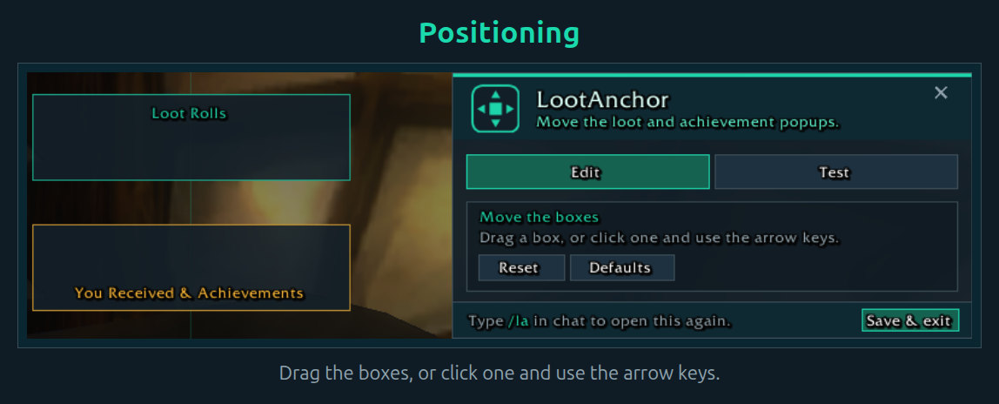
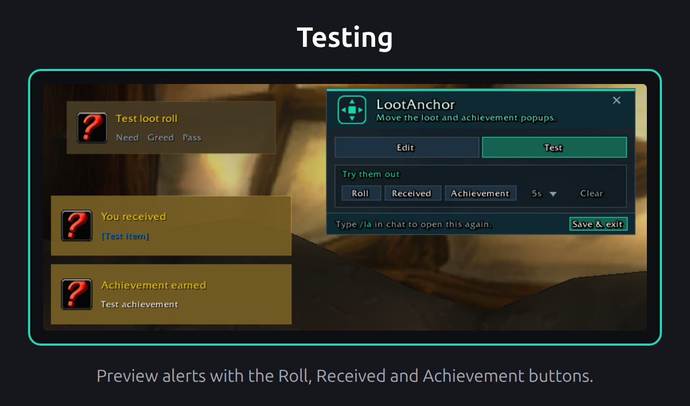

# LootAnchor

Move the default loot roll windows and the "You received" and achievement popups. No skins, no replacements.

<!-- release:start -->
  
<!-- release:end -->

## Usage

### The LootAnchor window

- `/la` or `/lootanchor`: open the LootAnchor window. Click **Save & exit**, the cross in the top right corner, or type `/la` again to close it and keep your positions. They are kept after `/reload`.
- Drag the window by its header; its position is remembered.
- **Edit** and **Test** switch between moving the boxes and trying them out.
- **Reset**: undo your changes since you opened LootAnchor.
- **Defaults**: reset to Blizzard's initial location and grow directions. The window position and test duration stay.

### Positioning

- On the **Edit** tab, drag the **Loot Rolls** and **You Received & Achievements** boxes where you want them. Boxes snap to the screen edges, the screen centre and each other, otherwise to a 10 pixel grid.
- Click a box to select it. Arrow buttons around it, and the arrow keys, move it. Hold a button to keep moving.
- The small box next to the selected box has **Grow up** / **Grow down** (which way the windows stack) and its **X** / **Y** position. Loot rolls and "You received" popups each have their own grow direction.

### Testing

- On the **Test** tab, **Roll**, **Received** and **Achievement** show a stand-in window so you can see where it lands and which way it grows. Click again for more.
- How long they stay: 5 seconds, 10 seconds, 20 seconds or until clicked.
- **Clear** removes every test window.

### Settings panel

- Settings > AddOns > LootAnchor has an **Open LootAnchor** button.

### Other notes

- `AlertFrame` also carries other alerts, so they move with the "You received" box.

## Development

Please see [CONTRIBUTING](CONTRIBUTING.md) for development checks and contribution guidance.

## Feedback

Please remember that I'm always working to improve the addon, so I'm interested in hearing directly from you about anything you want to share or ask. You can report this using the issues on GitHub.
When reporting bugs or unexpected behavior, include your addon version and an overview of your current options.

## Changelog

Please see the [CHANGELOG](CHANGELOG.md) for more information about recent changes.

## License

This project is open-sourced software licensed under the [MIT license](https://opensource.org/licenses/MIT).

## Support me

If you find my work valuable or just want to show your appreciation, you can buy me a coffee!

